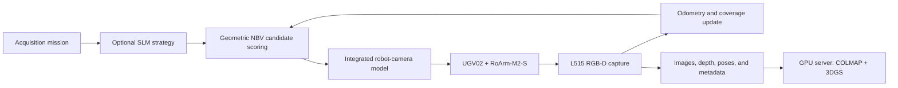

# model_robot

`model_robot` contains the kinematic, odometric, and camera models used by the
**autoNBV (Autonomous Next-Best-View)** project, together with the relevant
vendor reference materials.

The target hardware is:

- Waveshare UGV02 mobile base
- Waveshare RoArm-M2-S robot arm
- Intel RealSense L515 RGB-D camera
- Raspberry Pi 4 (4 GB) onboard computer

This repository is not the complete autoNBV runtime. Motion and camera I/O
remain behind the existing `vcrobot` hardware-control boundary. The models in
this repository provide a common foundation for deciding whether a candidate
view is physically reachable and for propagating robot motion into camera pose.

> **Calibration warning:** the supplied numerical configuration is nominal and
> uncalibrated. Measure the mounting transforms, camera intrinsics, and wheel
> odometry parameters before using the model on physical hardware.

## Project goal

autoNBV aims to let a robot select its next camera position and acquire the
RGB/RGB-D observations required for 3D reconstruction, instead of relying on a
person to specify every viewpoint manually.

The system separates responsibilities according to the available compute:

| Platform | Responsibility |
|---|---|
| Raspberry Pi 4 | Robot control, RGB-D capture, state estimation, lightweight candidate generation and scoring, and data logging |
| Ubuntu development server | Calibration, algorithm development, log analysis, and reproducible tests |
| GPU server | Offline COLMAP and 3D Gaussian Splatting (3DGS) reconstruction and quality evaluation |

On the Raspberry Pi, a small language model (SLM) is not used as a numerical
optimizer. When enabled, it acts only as a high-level planner that can suggest
an exploration direction or strategy. Deterministic geometric modules remain
responsible for evaluating visibility, coverage, information gain, overlap,
motion cost, pose confidence, and reachability.



## Why this integrated model exists

A geometrically useful viewpoint is not executable if it lies outside the arm
joint limits or if the camera pose after a UGV movement is unknown. The
manufacturer firmware frame and the actual camera mounting direction can also
differ from generic URDF or visualization assumptions.

The model therefore connects the following pieces:

- UGV wheel commands and encoder changes to base-pose increments
- RoArm firmware-compatible forward/inverse kinematics and joint limits
- Coordinate transforms among the base, arm mount, end effector, and L515
- World-frame camera position and optical-axis changes caused by robot motion
- Reachability and motion-cost information needed by the NBV planner
- A simulation-only OpenCV demo that never sends commands to physical motors

The central camera-pose composition is:

```text
T_WC = T_WB · T_BA · T_AE(q) · T_EC
```

- `W`: world frame
- `B`: UGV body frame
- `A`: RoArm firmware Cartesian frame
- `E`: modeled end-effector frame
- `C`: L515 optical frame
- `q`: arm joint state

Core translations use metres and angles use radians. See
[vcrobot/ROBOT_MODELING.md](vcrobot/ROBOT_MODELING.md) for the complete frame
contract, equations, firmware behavior, and model limitations.

## Repository layout

```text
model/
├── L515/          # Intel RealSense L515 reference source and materials
├── RoArm_M2_S/    # RoArm-M2-S vendor materials and examples
├── UGV02/         # UGV02 vendor materials and drivers
├── vcrobot/       # Integrated model, calibration tools, tests, and demos
├── .gitignore
└── README.md
```

The `L515`, `RoArm_M2_S`, and `UGV02` directories may contain third-party
source and documentation. The original licenses and notices in those
directories continue to apply. Provenance for the inspected reference files is
also recorded in `vcrobot/references/reference_manifest.yaml`.

## Current capabilities

The `vcrobot` package currently provides:

- A differential-drive approximation and encoder odometry for the UGV
- RoArm forward/inverse kinematics, workspace checks, and joint-limit checks
- Integrated UGV-arm-camera transforms and camera-motion accounting
- An L515 projection/deprojection camera model
- YAML-based nominal and calibrated parameter management
- Calibration validation and model-export utilities
- Unit tests
- An interactive OpenCV motion-model demo

The OpenCV demo also reflects the physical modifications described during
development:

- The gripper is shown in its 90-degree-rotated vertical mounting rather than
  the stock lateral opening direction.
- Smaller `t` values move the gripper proxy upward; larger values move it
  downward.
- The arm is rendered in 3D together with the world axes.
- The default display camera makes the arm's forward direction easier to see;
  this affects visualization only, not the model coordinate system.
- Firmware-compatible commands may be clamped in the demo, while strict IK is
  still used for NBV planning and reachability decisions.


## Quick start

### 1. Install dependencies

Install the Python dependencies in a Python 3 environment:

```bash
python3 -m pip install numpy pyyaml opencv-python matplotlib
```

On Raspberry Pi OS, OpenCV can alternatively be installed from the system
package repository:

```bash
sudo apt install python3-opencv
```

### 2. Run the tests

The WSL path for this repository is `/mnt/c/Research/autoNBV/model`.

```bash
cd /mnt/c/Research/autoNBV/model/vcrobot
python3 -m unittest discover -s tests -v
```

Validate the configuration and integrated model with:

```bash
python3 calibration/validate_robot_model.py \
  configs/robot_calibration.template.yaml
```

### 3. Run the OpenCV demo

```bash
cd /mnt/c/Research/autoNBV/model/vcrobot
python3 visualization/opencv_motion_demo.py
```

Click the window and enter commands in the same formats as the existing
control scripts:

```text
go 0.1 0.1     # left/right wheel velocity [m/s]
stop           # stop the UGV; keep the current arm target
10 0 100 3     # RoArm target x y z [mm] and gripper command t
reset          # reset base pose, arm pose, and trails
clear          # clear trails without changing the pose
quit           # close the demo
```

Use the Up/Down keys to recall command history. `Esc` also closes the window.
The demo is simulation-only and does not transmit commands to the motors.

Change the display azimuth when a different viewing direction is useful:

```bash
python3 visualization/opencv_motion_demo.py --view-azimuth-deg 90
```

Run a headless render check with:

```bash
python3 visualization/opencv_motion_demo.py \
  --smoke-test opencv_motion_demo_preview.png
```

## Python usage

The following example computes the camera pose and then applies one odometry
update:

```python
import numpy as np

from robot_models import IntegratedRobotCameraModel, RobotCameraOdometry

model = IntegratedRobotCameraModel.from_yaml(
    "configs/robot_calibration.template.yaml"
)

initial_joints = np.array([0.0, 0.0, np.pi / 2.0, np.pi])
T_WC = model.compute_camera_pose(
    base_pose=np.array([0.0, 0.0, 0.0]),
    joint_angles=initial_joints,
)

odometry = RobotCameraOdometry(
    model,
    base_pose=np.zeros(3),
    joint_angles=initial_joints,
)
update = odometry.update_wheel_velocity(
    v_left=0.1,
    v_right=0.1,
    dt=0.1,
    joint_angles=initial_joints,
)

print(T_WC)
print(update.base_pose_after)
print(update.camera_pose_after)
print(update.camera_total.distance_m)
```

Refer to [vcrobot/ROBOT_MODELING.md](vcrobot/ROBOT_MODELING.md) for cumulative
encoder feedback, firmware `x y z t` feedback, reachability checks, and the
remaining API examples.

## Calibration checklist before hardware use

The template configuration is not sufficient for precise NBV operation or
collision safety. At minimum, measure and validate:

- [ ] `T_BA`: UGV body frame to the RoArm firmware frame
- [ ] `T_EC`: RoArm modeled end frame to the L515 optical frame
- [ ] L515 intrinsics and distortion for every active stream resolution
- [ ] Wheel distance-per-count, left/right scale, and effective track width
- [ ] Skid-steer turning error under representative floor conditions
- [ ] Time synchronization among commands, encoders, joint feedback, and frames
- [ ] Self-collision, chassis/camera interference, and obstacle clearances

Begin validation with small motions and compare measured changes against model
predictions. A `reachable=True` result is a kinematic statement; it does not
prove that a path is collision-free or safe for physical hardware.

## Roadmap

autoNBV is intended to progress from a simple, testable baseline toward more
capable autonomous acquisition:

- [x] Nominal UGV-RoArm-L515 model and odometry foundation
- [x] Interactive OpenCV 3D simulation and regression tests
- [ ] Calibrate physical parameters and compare predictions with robot logs
- [ ] Implement a first NBV loop using 8-16 discrete viewpoint candidates
- [ ] Apply an **Arm-first, Base-assisted** policy: prefer arm-only views and
  move the UGV only when the arm cannot reach a useful view
- [ ] Score observed/unobserved regions and information gain from depth data
- [ ] Define a dataset contract for RGB, depth, pose, timestamps, calibration,
  commands, and feedback
- [ ] Evaluate results with COLMAP and 3DGS on the GPU server
- [ ] Add constrained SLM strategy planning and compare it against the
  deterministic geometric baseline
- [ ] Extend to multi-robot collaboration after the single-robot system is
  reliable

The guiding principles are that a language model must not replace geometry or
safety checks, and that every acquisition should be reproducible from its pose,
calibration, command, feedback, and timestamp records.

## Related documentation

- [Integrated robot-camera model](vcrobot/ROBOT_MODELING.md)
- [Reference provenance manifest](vcrobot/references/reference_manifest.yaml)
- `vcrobot/configs/`: model and calibration configuration
- `vcrobot/calibration/`: validation and calibration utilities
- `vcrobot/tests/`: unit tests
- `vcrobot/visualization/`: static and interactive visualization

