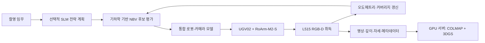
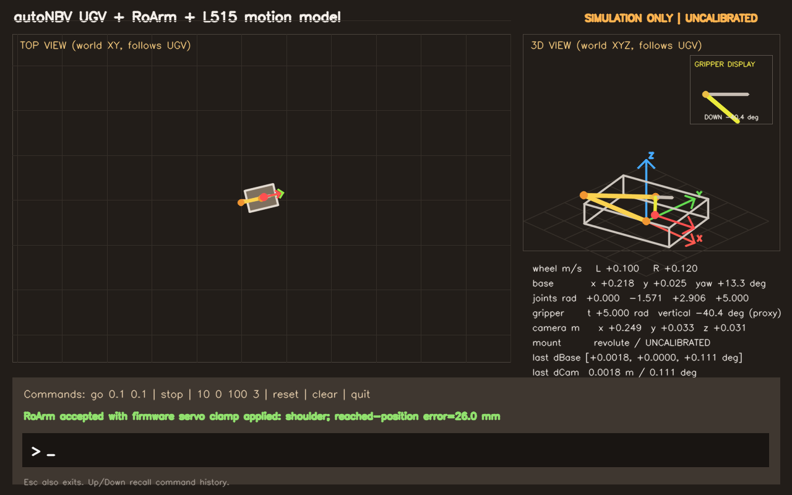

# model_robot

`model_robot`은 **autoNBV(Autonomous Next-Best-View)** 시스템에서 사용할 이동형 매니퓰레이터의 기구학·오도메트리·카메라 모델과 제조사 참고 자료를 모아 둔 저장소입니다.

대상 하드웨어는 다음과 같습니다.

- Waveshare UGV02 이동 베이스
- Waveshare RoArm-M2-S 로봇 팔
- Intel RealSense L515 RGB-D 카메라
- Raspberry Pi 4(4 GB) 온보드 컴퓨터

이 저장소 자체가 autoNBV 전체 실행 시스템은 아닙니다. 실제 이동·카메라 제어는 기존 `vcrobot` 코드와 연동하고, 이 저장소의 모델은 **후보 시점이 실제 로봇으로 도달 가능한지 계산하고 로봇의 움직임을 카메라 자세로 변환하는 공통 기반**을 제공합니다.

> 현재 제공되는 수치 모델은 nominal/uncalibrated 상태입니다. 실제 하드웨어에서 사용하기 전 반드시 장착 변환, 카메라 내부 파라미터, 휠 오도메트리를 실측 보정해야 합니다.

## autoNBV의 목적

autoNBV의 목표는 사람이 촬영 위치를 하나씩 지정하지 않아도 로봇이 물체 주변을 이동하며 다음 촬영 위치(Next Best View)를 선택하고, 3D 재구성에 필요한 RGB/RGB-D 데이터를 자율적으로 수집하도록 만드는 것입니다.

전체 시스템은 계산 자원에 따라 역할을 분리합니다.

| 실행 위치 | 주요 역할 |
|---|---|
| Raspberry Pi 4 | 로봇 제어, RGB-D 취득, 상태 추정, 경량 후보 생성·평가, 데이터 기록 |
| Ubuntu 개발 서버 | 모델 보정, 알고리즘 개발, 로그 분석과 재현 시험 |
| GPU 서버 | COLMAP 및 3D Gaussian Splatting(3DGS) 기반 오프라인 재구성·품질 평가 |

Raspberry Pi에서는 작은 언어 모델(SLM)을 수치 최적화기로 쓰지 않습니다. SLM은 필요할 때 탐색 방향이나 전략을 제안하는 상위 계획기로만 사용하며, 실제 후보의 가시성·커버리지·정보 이득·중첩도·이동 비용·도달 가능성 평가는 결정론적인 기하학 모듈이 담당하는 방향을 지향합니다.



## 이 통합 모델을 만든 이유

NBV 알고리즘이 계산한 좋은 시점도 로봇 팔의 관절 범위를 벗어나거나, UGV 이동 후의 카메라 자세를 알 수 없으면 실행할 수 없습니다. 또한 제조사 펌웨어의 좌표계와 실제 카메라 장착 방향은 단순한 시각화 모델 또는 일반적인 URDF 가정과 다를 수 있습니다.

따라서 다음 문제를 하나의 모델로 연결했습니다.

- UGV 휠 명령·엔코더 변화에서 베이스 자세 변화를 계산
- RoArm 펌웨어와 호환되는 순기구학(FK)·역기구학(IK) 및 관절 제한 처리
- 베이스, 팔 장착점, 엔드이펙터, L515 사이의 좌표 변환
- 로봇 이동 전후의 월드 기준 카메라 위치·광축 변화 계산
- NBV 후보의 도달 가능성 검사와 이동 비용 계산에 필요한 상태 제공
- 실제 로봇에 명령을 보내지 않고도 OpenCV 창에서 동작을 확인하는 데모 제공

핵심 카메라 자세는 다음 변환으로 표현합니다.

```text
T_WC = T_WB · T_BA · T_AE(q) · T_EC
```

- `W`: 월드 좌표계
- `B`: UGV 베이스 좌표계
- `A`: RoArm 장착 기준 좌표계
- `E`: 엔드이펙터 좌표계
- `C`: L515 카메라 좌표계
- `q`: 로봇 팔 관절 상태

좌표 단위는 내부적으로 미터와 라디안을 사용합니다. 상세한 좌표계 정의, 수식, 펌웨어 호환 조건은 [vcrobot/ROBOT_MODELING.md](vcrobot/ROBOT_MODELING.md)를 참고하세요.

## 저장소 구성

```text
model/
├── L515/          # Intel RealSense L515 참고 소스 및 자료
├── RoArm_M2_S/    # RoArm-M2-S 제조사 자료와 예제
├── UGV02/         # UGV02 제조사 자료와 드라이버
├── vcrobot/       # 통합 수학 모델, 보정 도구, 테스트, 시각화 데모
├── .gitignore
└── README.md
```

`L515`, `RoArm_M2_S`, `UGV02`에는 제3자 코드와 자료가 포함될 수 있습니다. 각 하위 폴더에 포함된 원 저작자의 라이선스와 고지를 우선 적용해야 합니다. 출처와 사용 목적은 `vcrobot/references/reference_manifest.yaml`에도 정리되어 있습니다.

## 현재 구현 범위

`vcrobot` 패키지에는 다음 기능이 구현되어 있습니다.

- UGV 차동구동 근사 운동학과 엔코더 기반 오도메트리
- RoArm 순기구학, 역기구학, 작업공간 및 관절 제한 검사
- UGV–팔–카메라 통합 변환과 카메라 자세 변화량 계산
- L515 투영·역투영에 사용할 카메라 모델
- 설정 파일 기반 명목 파라미터 관리
- 보정값 검증 및 데이터 내보내기 도구
- 단위 테스트
- 명령 입력이 가능한 OpenCV 실시간 모션 데모

OpenCV 데모에는 사용자 로봇의 실제 장착 형태도 반영되어 있습니다.

- 그리퍼는 기본 좌우 개폐가 아니라 90° 회전된 상하 운동으로 표시
- 그리퍼 명령 `t`가 작을수록 위쪽, 클수록 아래쪽으로 표시
- 3차원 팔 자세와 월드 좌표축 표시
- 화면에서 팔의 진행 방향을 보기 쉽도록 기본 뷰를 XY 평면에서 90° 회전
- 펌웨어가 허용하는 명령은 데모에서 제한값으로 보정하되, NBV 계획용 엄격한 IK 판정은 별도로 유지



## 빠른 시작

### 1. 의존성 설치

Python 3 환경에서 다음 패키지를 설치합니다.

```bash
python3 -m pip install numpy pyyaml opencv-python matplotlib
```

Raspberry Pi OS에서는 환경에 따라 OpenCV를 시스템 패키지로 설치할 수도 있습니다.

```bash
sudo apt install python3-opencv
```

### 2. 테스트 실행

WSL 기준 경로는 `/mnt/c/Research/autoNBV/model`입니다.

```bash
cd /mnt/c/Research/autoNBV/model/vcrobot
python3 -m unittest discover -s tests -v
```

설정 파일과 통합 모델을 검증하려면 다음을 실행합니다.

```bash
python3 calibration/validate_robot_model.py \
  configs/robot_calibration.template.yaml
```

### 3. OpenCV 데모 실행

```bash
cd /mnt/c/Research/autoNBV/model/vcrobot
python3 visualization/opencv_motion_demo.py
```

창 아래 입력란에 기존 제어 스크립트와 같은 형식으로 명령을 입력합니다.

```text
go 0.1 0.1     # 왼쪽/오른쪽 휠 속도 [m/s]
stop           # UGV 정지
10 0 100 3     # RoArm 목표 x y z [mm]와 그리퍼 명령 t
reset          # 초기 상태로 복귀
clear          # 이동 궤적 삭제
quit           # 종료
```

위·아래 방향키로 이전 명령을 불러올 수 있고 `Esc`로도 종료할 수 있습니다. 데모는 시뮬레이션 전용이며 실제 모터에는 명령을 전송하지 않습니다.

화면 방향을 바꾸려면 뷰 방위각을 지정합니다.

```bash
python3 visualization/opencv_motion_demo.py --view-azimuth-deg 90
```

GUI 없이 설치 상태만 확인하려면 다음 스모크 테스트를 사용할 수 있습니다.

```bash
python3 visualization/opencv_motion_demo.py \
  --smoke-test opencv_motion_demo_preview.png
```

## Python에서 사용하기

통합 모델의 기본 사용 형태는 다음과 같습니다.

```python
import numpy as np

from robot_models import IntegratedRobotCameraModel, RobotCameraOdometry

model = IntegratedRobotCameraModel.from_yaml(
    "configs/robot_calibration.template.yaml"
)

# 현재 베이스 자세와 팔 관절값으로 월드 기준 카메라 자세 계산
initial_joints = np.array([0.0, 0.0, np.pi / 2.0, np.pi])
T_WC = model.compute_camera_pose(
    base_pose=np.array([0.0, 0.0, 0.0]),
    joint_angles=initial_joints,
)

# 휠 속도와 팔 상태 변화가 카메라 자세에 미친 변화 추적
odom = RobotCameraOdometry(
    model,
    base_pose=np.zeros(3),
    joint_angles=initial_joints,
)
update = odom.update_wheel_velocity(
    v_left=0.1,
    v_right=0.1,
    dt=0.1,
    joint_angles=initial_joints,
)

print(update.base_pose_after)
print(update.camera_pose_after)
print(update.camera_total.distance_m)
```

세부 API와 실제 설정 이름은 [vcrobot/ROBOT_MODELING.md](vcrobot/ROBOT_MODELING.md)의 예제를 기준으로 사용하세요.

## 실제 로봇 적용 전 보정 체크리스트

현재 예제 설정값만으로는 정밀한 NBV 또는 충돌 안전성을 보장할 수 없습니다. 최소한 아래 항목을 실측해야 합니다.

- [ ] UGV 베이스에서 RoArm 기준점까지의 변환 `T_BA`
- [ ] RoArm 엔드이펙터에서 L515 광학 좌표계까지의 변환 `T_EC`
- [ ] 실제 스트림 해상도별 L515 내부 파라미터와 왜곡 계수
- [ ] 좌우 휠 거리당 펄스 수, 속도 스케일, 유효 윤거(track width)
- [ ] 스키드 스티어 회전 오차와 바닥 조건별 보정값
- [ ] 로봇 명령, 엔코더, 관절 피드백, 카메라 프레임의 시간 동기화
- [ ] 자체 충돌, 차체·카메라 간섭 및 주변 장애물 안전거리

검증은 작은 이동부터 시작해 모델의 예측 변화량과 실측 변화량을 비교하는 방식으로 진행합니다. 모델의 `reachable=True` 결과는 기구학적 판정이며, 충돌이 없거나 실제 장비가 안전하다는 의미는 아닙니다.

## 개발 방향

autoNBV는 먼저 단순하고 검증 가능한 구조를 완성한 뒤 단계적으로 지능을 추가합니다.

- [x] UGV–RoArm–L515 명목 통합 모델과 오도메트리 기반 구축
- [x] OpenCV 명령 입력형 3D 시뮬레이션 및 회귀 테스트
- [ ] 실측 파라미터 보정과 실제 로봇 로그 비교
- [ ] 8–16개 이산 후보 시점 기반의 1차 NBV 루프
- [ ] **Arm-first, Base-assisted** 정책: 팔로 가능한 시점을 우선하고 필요할 때만 UGV 이동
- [ ] 깊이 영상 기반 관측 영역·미관측 영역 및 정보 이득 평가
- [ ] 촬영 데이터 계약 정립: RGB, depth, camera pose, timestamp, calibration, command/feedback
- [ ] GPU 서버의 COLMAP·3DGS 결과를 이용한 정량 평가와 정책 개선
- [ ] 제한적인 SLM 전략 계획을 추가하고 기하학 결과와 비교 검증
- [ ] 단일 로봇 안정화 후 다중 로봇 협업으로 확장

핵심 원칙은 **언어 모델이 기하학과 안전 판정을 대체하지 않도록 하는 것**, 그리고 모든 촬영 결과가 자세·보정값·명령·피드백과 함께 재현 가능하게 기록되도록 하는 것입니다.

## 관련 문서

- [통합 로봇 모델 상세 설명](vcrobot/ROBOT_MODELING.md)
- [참고 자료 출처 목록](vcrobot/references/reference_manifest.yaml)
- `vcrobot/configs/`: 보정 및 모델 설정
- `vcrobot/calibration/`: 검증·보정 도구
- `vcrobot/tests/`: 단위 테스트
- `vcrobot/visualization/`: 정적 및 OpenCV 시각화

